# Frida 0x1 — Baby Hook

While checking the MainActivity in JADX, I noticed that the value used in check() comes from the get_random() method.
Instead of trying to guess the random number, I thought of using Frida to hook get_random() and make it return a value that I choose.

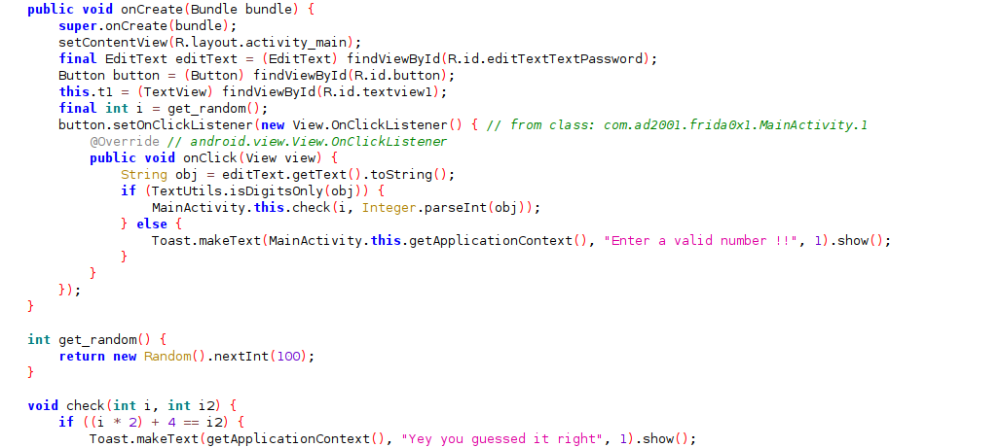

I used this script:

```
Java.perform(function () {

    var MainActivity = Java.use("com.ad2001.frida0x1.MainActivity");

    console.log("MainActivity loaded");

    MainActivity.get_random.implementation = function () {

        console.log("get_random() called");

        return 1;
    };

});
```

This gave fridaa access to the Mainactivity and replace the original get_random method
I then ran the script using

```
frida -U -f com.ad2001.frida0x1 -l script.js
```

As I used the value returning as 1 in the script , i used 6 in the app ui as that satisfied the check func and got the flag.

Flag: FRIDA{BABY_HOOK_0x1}

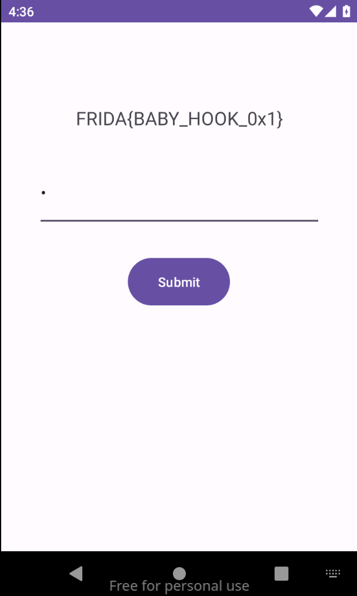

# Frida 0x2

While checking the MainActivity code, I noticed that the get_flag() method only continues when the argument passed to it is 4919.

I learned how one could call static methods using scripts.  
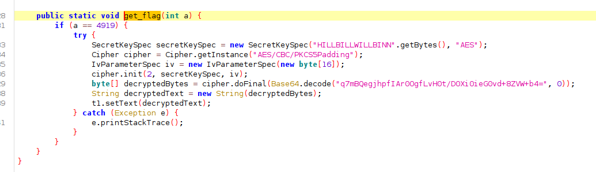

Since the required value was already visible in JADX, I thought of using Frida to directly call get_flag() with 4919.
I used this script and I directly called the get_flag() method with the required value:

```
Java.perform(function(){
    var MainActivity = Java.use("com.ad2001.frida0x2.MainActivity");
    console.log("hello");
    MainActivity.get_flag(4919)

});
```

I then ran the script using

```
frida -U -f com.ad2001.frida0x2 -l script.js
```

and since condition was satisfied , I got the flag  
Flag: FRIDA{BABY_HOOK_0x2}

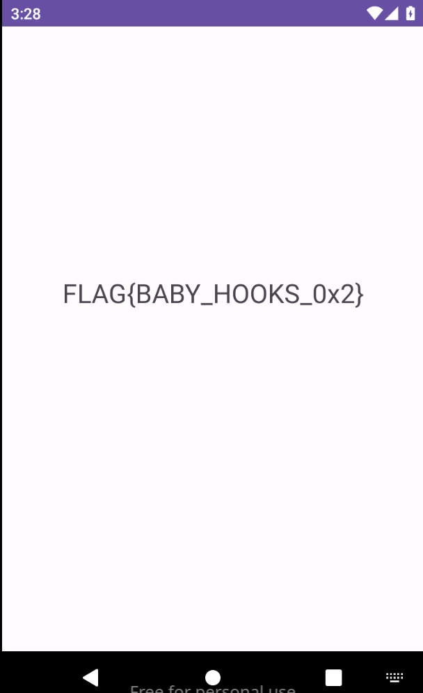

# Frida 0x3

While checking the MainActivity code, I noticed that there was a button in MainActivity which only works and shows the flag if the variable code present in the Checker class had a value of 512.

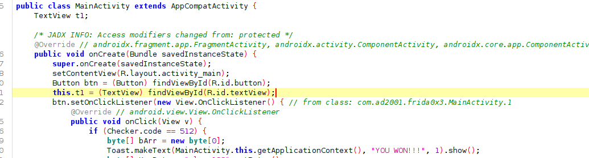

I noticed that the variable was static so I could easily change the value of the variable.

I used this script:

```
Java.perform(function(){
    var Checker = Java.use("com.ad2001.frida0x3.Checker");
    Checker.code.value=512;
});
```

I then ran the script using

```
frida -U -f com.ad2001.frida0x3 -l script.js
```

and since now value was changed i got the flag.  
Flag : FRIDA{INJECT_AND_INSPECT}  
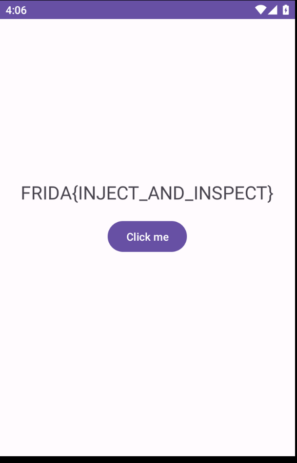

# Frida 0x4

While checking the apk code in JADX. I noticed that nothing important was to be found in the MainActivity. From the description of the challenge i knew that i had to make a class instance so I then proceeded to find any useful classes. I then got the class Check which had a method get_flag which gave the flag .

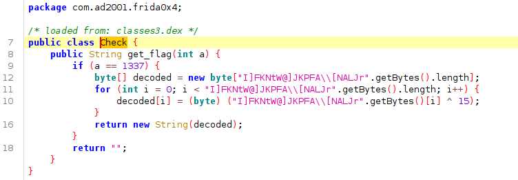

So this meant I had to make an instance of that class and use the method get_flag .  
I used this script to do that :

```
Java.perform(function(){
    var Check = Java.use("com.ad2001.frida0x4.Check");
    var instance = Check.$new();
    console.log("hello");
    var result = instance.get_flag(1337);
    console.log(result);
});
```

I then got the flag in my terminal as the get_flag() returned the flag as a string:  
Flag : FRIDA{XORED_INSTANCE}

# Frida 0x5

While looking at the code of MainActivity , I understood that I somehow have to call the method flag.

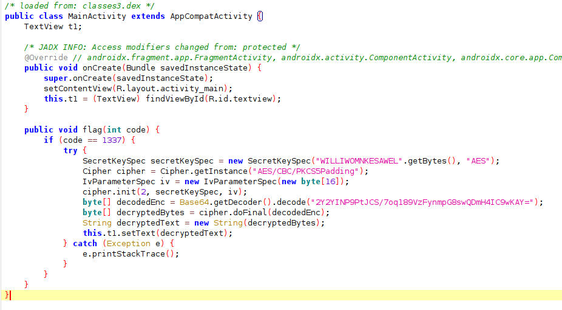

But i figured I cannot call the method by just creating an instance like before as this is an Activity . But as this is the launcher activity, an instance of this is made during the apps lifecycle.  
So we need to use the method in the existing instance, I did this using this script:

```
Java.performNow(function(){
    Java.choose("com.ad2001.frida0x5.MainActivity",{
        onMatch: function (instance) {
            instance.flag(1337);
        },
        onComplete: function() {}
    });
})
```

Here Java.choose is used to go through every instances of the Activity which is present where as Java.performNow lets us execute code within the context of the Java runtime.
The onMatch is execuuted for every instances present and thus the method is called inside with the proper paramter.
this resulted me to get the flag from the ui of the App.  
Flag : FRIDA{ON_MATCH_THIS_INSTANCE}

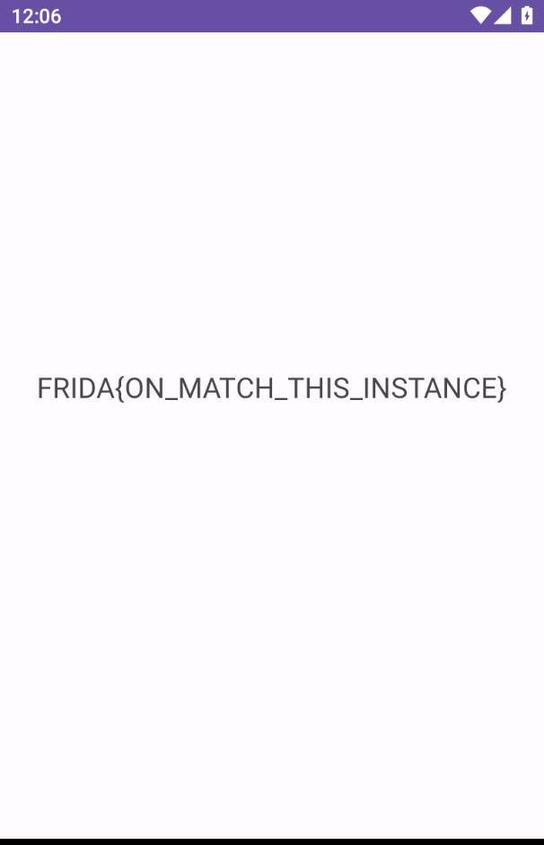

# Frida 0x6

While looking at the MainActivity code in jadx. I again found that i have to call the function get_flag, but this time the parameter for it was an instance of the Checker class.

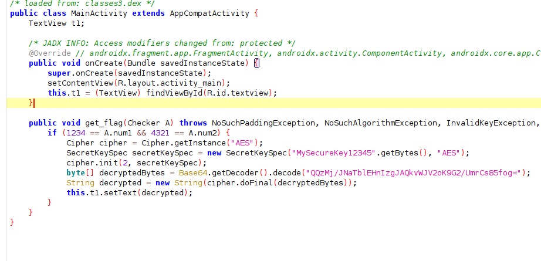

So again first i need to use the method in the existing instance of the MainActivity like before but here i also need to create an instance for the Checker class So i did that by using the commands previously used (Java.performNow, Java.choose,onMatch,class.$new(for creating new instance))

Also I had to change the values of the variables in the instance of Checker class, so as to satisfy the condition.

so I basically used this script:

```
Java.performNow(function(){
    Java.choose("com.ad2001.frida0x6.MainActivity",{
        onMatch : function(instance){
            var Checker = Java.use("com.ad2001.frida0x6.Checker")
            var Checker_instance=Checker.$new();
            Checker_instance.num1.value=1234;
            Checker_instance.num2.value=4321;
            instance.get_flag(Checker_instance)
        }
    }
    );
})
```

Hence i got the flag in the UI:
Flag : FRIDA{INSTANCES_AND_INSTANCES}  
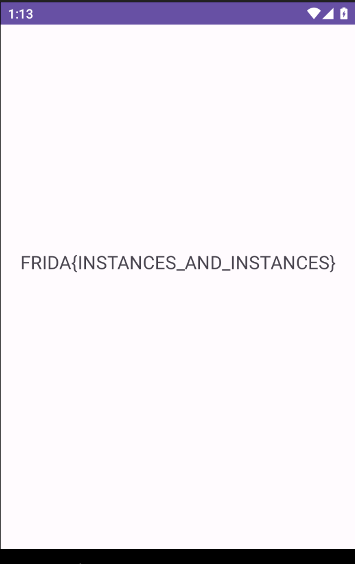

# Frida 0x7

While looking at the MainActivity code , I understood that an object is being made for the class Checker and its paramters initialise the values of the variables of the object.
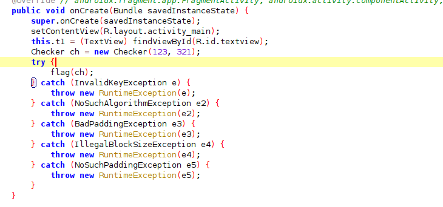

Checker class:

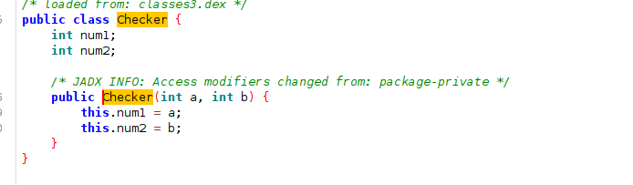

And as always there was a method flag which was called with its parameter as the object so created of Checker class. And in that method it requires the values of the variables of the passed objects to be greater than 512.
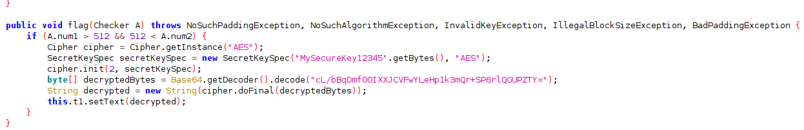
Thus I needed to hook the constructor of the Checker class such that the values of those variables satisfied the condition.

Here i used Targetclass.$init to hook the constructor of the class , and used overload with the datatypes of paramters so it knows which construct to hook.then i called the initial constructor and then changed the values of the num1 and num2 variables.
I used this script to do so:

```
Java.perform(function(){
    var Checker=Java.use("com.ad2001.frida0x7.Checker");
    Checker.$init.overload('int','int').implementation=function(arg1,arg2){
        this.$init(arg1,arg2)
        this.num1.value=513;
        this.num2.value=513;

    }

})
```

I then got the flag from the UI.  
Flag : FRIDA{HOOKING_CONSTRUCTORS}


# Flag 0x8

Frigg here we go..
Insttalled the app and opened the app. It asks for an input from the user .

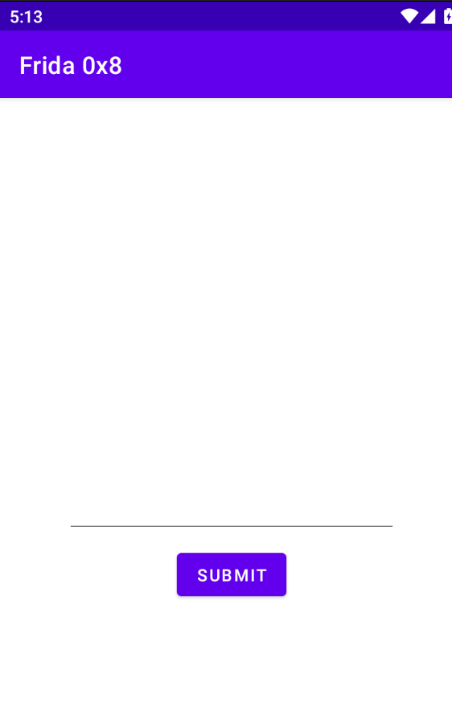
like usual i then started inspecting the jadx code of mainactivity i noticed that there exists a native library name libfrida0x8.so and that constains a function named cmpstr and that function is being called with the paramter as our input from the ui .
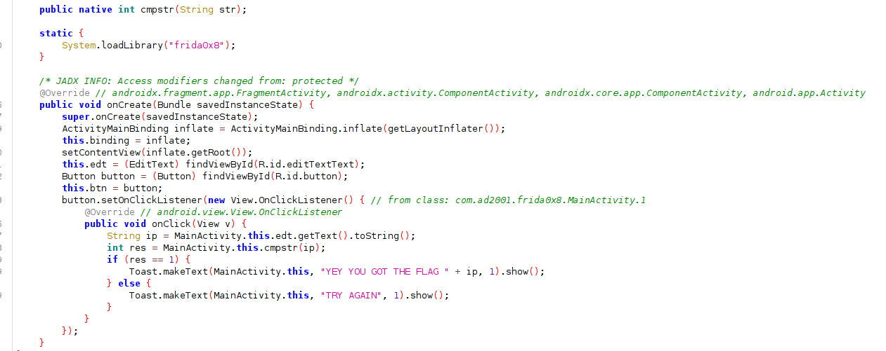
As i couldnt see much from the jadx code i used ghidra to open the libfrida0x8.so file.

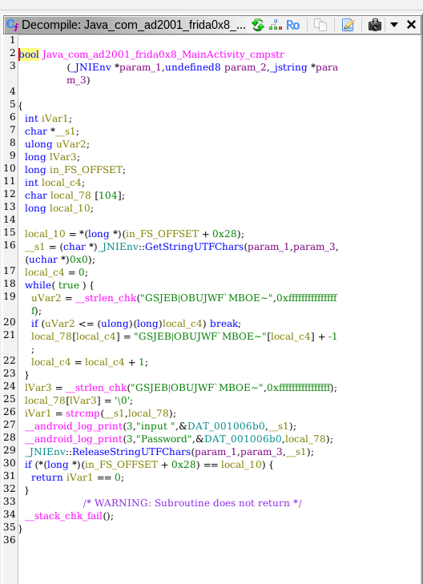

I noticed that inputted parameter is being compared with the real flag . the real flag is only visble in runtime as its being converted to the flag during runtime (local_78) . the comparison is being done with the c funnction strcmp and its paramters are the inputted string (\_\_s1) and the final real flag (local_78) so I understood that what i need to do is hook the strcmp function and access its parameters and get the flag paramter.
The strcmp functiom resides in the libc.so file

But the problem i faced was that when i tried to hook the strcmp function it hooked every use of the strcmp function whereas i only need to know the argument of the strcmp which has the flag as paramter. But i dont know the flag yet but what i can control is the input we give in the ui and that is a paramter aswell. so i gave it a random name and check the strcmp whose argument[0] is the name and then printed the other argument .

For these I used various set of commands - Module.findExportByName (to go through the exported functions in libc.so and in that the one named strcmpand return its address) Interceptor is the API used to hook native functions and attach connects the frida to the runtime, Memory.readUtf8String() to convert the address to the string value.
I figured we need to use this script:

```
var address = Module.findExportByName("libc.so", "strcmp");
console.log(address)

Interceptor.attach(address,{
    onEnter: function(args){
        var args0=Memory.readUtf8String(args[0]);
        var args1=Memory.readUtf8String(args[1]);
        if (args0=="narain"){
            console.log(args1)
        }

    }
})
```

After running this script in Frida I entered narain in the ui of the app and it printed the flag
Flag : FRIDA{NATIVE_LAND}

# Frida 0x9

I installed the app and opened it and it showed me a button and when i clicked it ,it showed me try again.
i then used jadx to see the code of the apk and in the code I found that a native function check_flag was being called here from the liba0x9.so . and if the value returned by that function was 1337 then the flag was displayed in the ui.

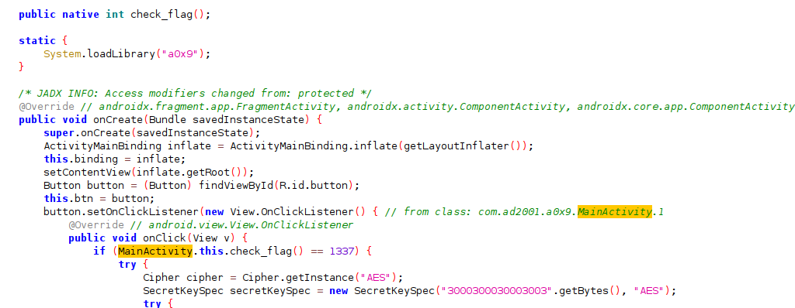

So i opened the liba0x9.so in ghidra and opened the function Java_com_ad2001_a0x9_MainActivity_check_1flag and it showed that it returns 1

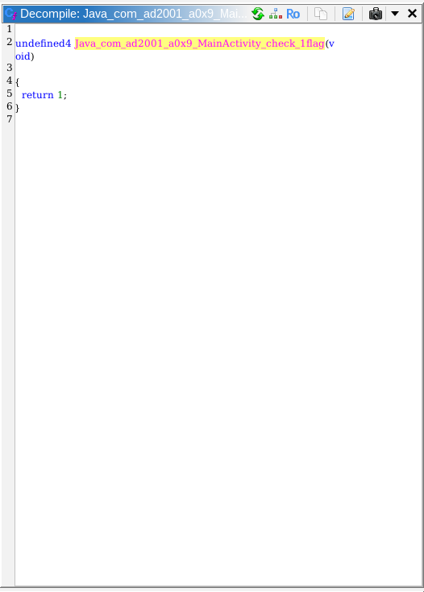

So i understood that i need to hook the function check_flag and change its return value to 1337 and hell of a task it was, the version 16.9.0. does not even work for this level and it just shows null when i check the exports in the liba0x9.so file .  
So i changed the version to 16.6.6 for this to work . Similar to before i used findExportByName to get address of the func check_flag and used Interceptor.attach and connected native functions to runtime and here as i needed to change the return value instead of the paramters I needed to use to the onLeave : function(retval) where the retval contained the return value which should be changed to 1337 .  
I used this script :

```
var address = Module.findExportByName("liba0x9.so","Java_com_ad2001_a0x9_MainActivity_check_1flag");
console.log(address);

Interceptor.attach(address, {
    onEnter: function (args) {
        console.log("working")
    },

    onLeave: function (retval) {

        retval.replace(1337);
    }
});
```

after running this script , i clicked the button and it showed the flag .

Flag : FRIDA{NATIVE_LAND_0x2}


# Frida 0xA

I started by opening up the application and it didn't show anything useful so i opened the code in jadx and looked at the mainactivity code .  
I noticed that the code was actually written in kotlin.
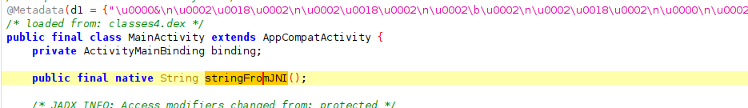

It showed that there was a stringfromJNI function imported from the native and used in the code. So inorder to understand more . I decompiled the apk and opened the libfrida0xa.so file in ghidra . I saw that there existed two exported functions one was the stringfromJNI which was shown in mainactivity, the next was get_flag. I inspected the visible code of both of these functions .  
I understood that the function stringfromJNI was responsible for the text visible in the UI , hence not much useful for me .  
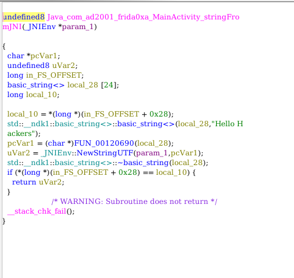

But that was not the case for the get_flag it actually logged the flag if a specific condition was satisfied , that was if its parameters sum up to 3 .
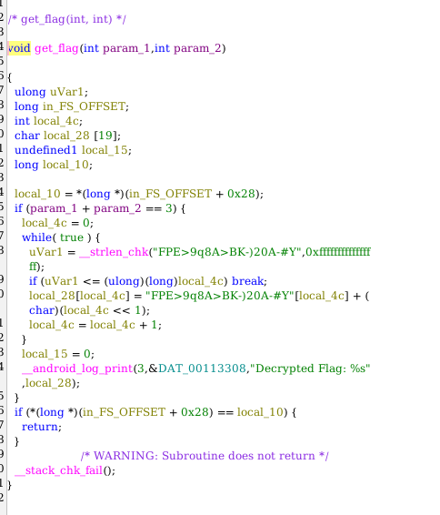

So with this and the given description in the frida github repo that this level is about calling a native function which is get_flag .

I learned about the function nativeFunction which allowed for native functions to be called .
So inorder to find the exported set of functions or variables, I ran the command Module.enumerateExports("libfrida0xa.so") in frida which showed list of names of function ,its address and type .

i couldnt find any function exactly named get_flag but there was a function \_Z8get_flagii . this was actually a mangled name version of the get_flag. So I had to call this function during runtime with the parameters adding up to 3.  
NativeFunction needed 3 things :

1. function's address ( this was found at runtime using the findexportbyname function)
2. the return type ( void - visible in the ghidra code)
3. the data type of its parameters as an array. ( both as integers )

I used this script:

```
var address = Module.findExportByName("libfrida0xa.so", "_Z8get_flagii");
console.log(address);

if (address !== null) {
    var getflag = new NativeFunction(address, "void", ["int", "int"]);
    getflag(1, 2);
}
```

and after this i checked the logcat using

```
adb logcat | grep "FRIDA"
```

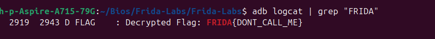

Flag: FRIDA{DONT_CALL_ME}

# Frida 0xB

I started by opening the app frida 0xB , it just showed a button in its ui , So i opened the apk in jadx to see its code, i understood that a native function was used here named get*flag and it was used inside a method which was called whenever the button is clicked in its UI.
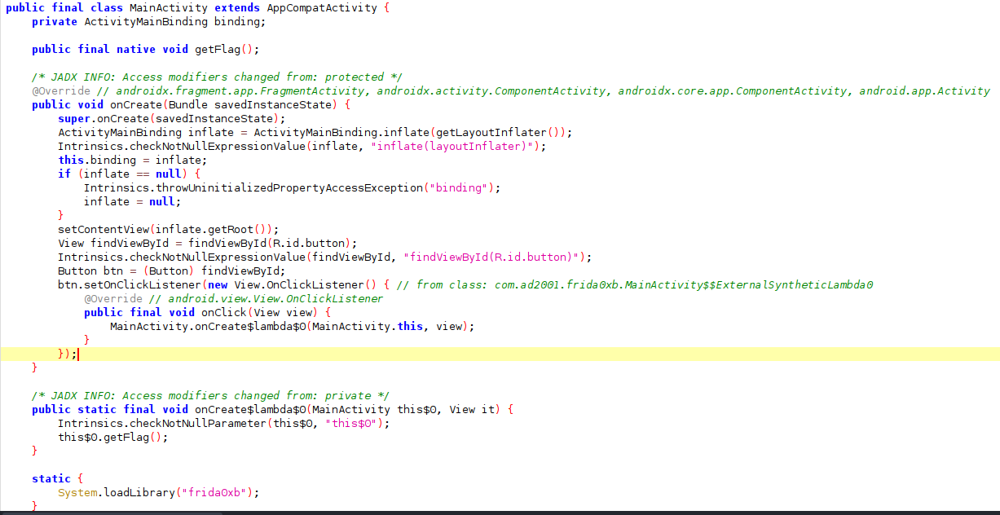  
As this contained native methoods , i decompiled using apktook and opened the libfrida0xb.so file in ghidra . I then opened the get_flag in functions. But i noticed that the get_flag method didnt show any relevant code in the decompiled version .  
Another thing i noted was that it showed * WARNING: Removing unreachable block * several times along with addresses of the main memory.
I resarched about this and understood that there will be some consition for the real code of that function to work and as that condition was never satisfied , Ghidra took it as an Unreachable Block of code .  
I looked at the assembly code of the get_flag method and found this.  
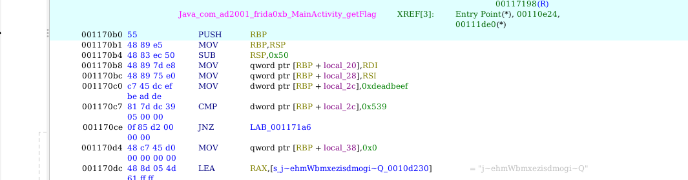

I noticed that the line MOV dword ptr [RBP + local_2c],0xdeadbeef saves the 0xdeadbeef to the address [RBP + local_2c] and the next line CMP dword ptr [RBP + local_2c],0x539 this compares the value of [RBP + local_2c] to 0x539 and these implies that if the conditon was satisfied it returns 0 and the lines below would be executed ,but if not it would skip and goto another line which returns back.  
So this cleared my doubts , as the 0xdeadbeef and 0x539 were never equal , ghidra automatically removed the unreachable code. So at first I though of changing the values in Ghidra so that the condition was satisfied and I could see the code which was intended. So i then changed 0xdeadbeef to 0x539 .It then revealed the code in ghidra .  
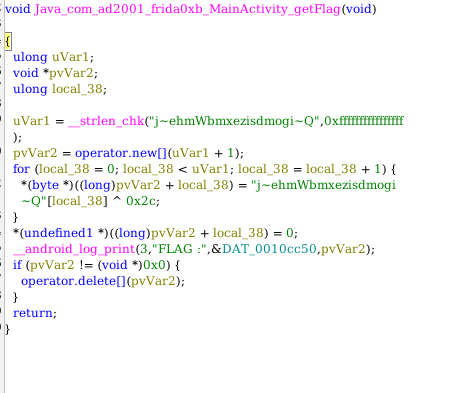  
This code showed me that once the button was clicked, the flag will be logged. But first inorder to do that I need to patch the assembly code of the method such that the condition of CMP will be satisfied .  
I used x86Writer inorder to change the Bytes of 0xdeadbeef to that of 0x539.  
The approach I followed was, First i saved the base address of our libfrida0xb.so file .and then added the address of the method getflag to the base address .I got the address of the method from ghidra which showed the offset i should add .
Then on analysing the mthod in detail i found that when i changed 0xdeadbeef (c7 45 dc ef be ad de) to 0x539 (c7 45 dc 39 05 00 00) the first three bytes stayed the same . So I just need to change the last 4 bytes so i added 3 to the address specified before in order to specify the exact address of the bytes i needed to overwrite.
Then I put the new Bytes to be changed to which i got from ghidra. Used writer.flush to implement it in runtime.  
I used the script:

```
var baseAddress = Module.getBaseAddress("libfrida0xb.so");

var patchaddress = baseAddress.add(0x170c0);
var immediateAddress = patchaddress.add(3);

Memory.patchCode(immediateAddress, 4, function (code) {

    var writer = new X86Writer(code, {
        pc: immediateAddress
    });

    writer.putBytes(
        new Uint8Array([0x39, 0x05, 0x00, 0x00]).buffer
    );

    writer.flush();
    writer.dispose();
});
```

I then checked the logcat using adb and got the flag.
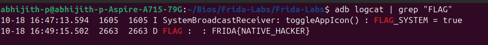

Flag: FRIDA{NATIVE_HACKER}
